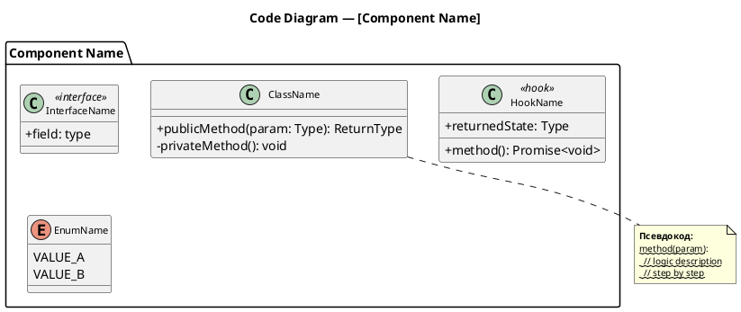

# C4 Code Diagrams Generator (Level 4)

Generate C4 level 4 (Code) diagrams in **PlantUML (.puml)** format — one file per component.

**Prerequisite:** levels 1–3 must already exist (generated by the `c4-diagrams` skill). If `docs/architecture/c4-3-component.puml` does not exist, tell the user:

> Сначала сгенерируйте диаграммы уровней 1–3 с помощью `/c4-diagrams`, а затем запустите `/c4-code`.

## Step 1 — Read Existing Diagrams

Read the following files to understand the system architecture:
- `docs/architecture/c4-3-component.puml` (required) — list of all components
- `docs/architecture/c4-2-container.puml` (optional) — container structure
- `docs/architecture/c4-1-context.puml` (optional) — system context

Extract the list of containers the team controls and their components.

## Step 2 — Determine Scope

If the user provided arguments (container name or component name), generate code diagrams only for the specified scope.

If no arguments provided, generate code diagrams for ALL components of ALL controlled containers.

**Never generate code diagrams for managed/external services** (Supabase, Firebase, AWS managed services, etc.).

## Step 3 — Collect Source Documents

If technical specification documents were not provided in the current conversation, ask:

> Укажите ссылки на техническую документацию/спецификацию для генерации детальных code-диаграмм.

Read each document. If the user has already provided documents (via @ mentions or direct paths), proceed with those.

## Step 4 — Generate Code Diagrams

### Output Structure

```
docs/architecture/
├── <container-name>/          One subfolder per controlled container
│   ├── c4-4-<component>.puml  One code diagram per component
│   ├── c4-4-<component>.puml
│   └── ...
└── <container-name>/
    ├── c4-4-<component>.puml
    └── ...
```

**Naming rules:**
- Container subfolder names: kebab-case derived from the container name (e.g., "Bot Logic" → `bot-logic/`, "Web Admin" → `web-admin/`)
- Code diagram file names: `c4-4-<component-name-kebab>.puml`

### Code Diagram Template



### Rules

- Show classes, interfaces, hooks, enums, utility functions relevant to the component
- Include TypeScript pseudocode in `note` blocks explaining key logic
- Use `~~strikethrough~~` for pseudocode lines inside notes (renders as monospace in PlantUML)
- Choose the right abstraction per component:
  - Backend logic → classes, methods, business rules
  - React UI → components (with `<<React Component>>`), hooks (with `<<hook>>`), props interfaces
  - Utilities → functions, types
- Show relationships between internal elements: `-->` (dependency), `..>` (uses/creates)
- Include specific business rules, thresholds, and algorithms from the spec
- Pseudocode should convey the IDEA, not be copy-paste-ready code

### Pseudocode Guidelines

- Write pseudocode in the same language as the codebase (TypeScript by default)
- Include specific values: timeouts, limits, thresholds from the spec
- Show the happy path + key edge cases
- For async flows, show await points
- For state machines, show all transitions
- For UI components, show key user interactions and data flow

---

## PlantUML General Rules

- Each .puml file must be self-contained and renderable independently
- Use meaningful IDs for elements
- Include descriptions in all elements explaining their purpose
- Write in the same language as the source documents (typically Russian for this project)

## Validate Syntax by Rendering

After writing the `.puml` files, render each one to PNG to confirm the PlantUML syntax is valid — a file that fails to render is broken no matter how correct the source looks.

1. Render every generated `.puml` to PNG, e.g. `plantuml -tpng docs/architecture/**/*.puml` (or per-file `plantuml -tpng <file>.puml`). If PlantUML is not installed locally, fall back to any available renderer (Docker image `plantuml/plantuml`, the PlantUML server, etc.).
2. If a render fails, read the error, fix the `.puml` source, and re-render until every file succeeds.
3. **Delete the generated PNG files once rendering succeeds** — they are only a syntax check, not an artifact of this skill. Leave only the `.puml` sources.

Never leave `.png` files behind.

## Quality Checklist

Before finishing, verify:
- [ ] One file per component, in the correct container subfolder
- [ ] Each code diagram has TypeScript pseudocode with business logic
- [ ] No managed/external services have code diagrams
- [ ] All files render independently
- [ ] Every `.puml` was rendered to PNG to verify syntax, and the PNGs were deleted afterward
- [ ] Container subfolders use kebab-case names