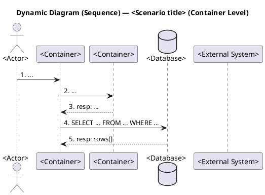

# C4 Dynamic Diagrams Generator

Generate C4 **dynamic** diagrams: numbered, container-level runtime flows for specific scenarios.

**Two diagrams per use case — the same flow drawn in two visual styles:**
1. **Communication diagram** — the C4 dynamic (a.k.a. UML *communication* / *collaboration*) style: free-positioned boxes with numbered relationships. Best for seeing topology — who talks to whom.
2. **Sequence diagram** — participants with lifelines, messages top-to-bottom in time order. Best for seeing chronology and request/response pairing.

Both diagrams describe the **identical** numbered flow (same steps, same numbers, same data on each arrow) — only the visual representation differs. Generate both for every scenario.

This skill is distinct from:
- `c4-diagrams` — static structure (Levels 1–3 + Deployment)
- `in-arch-sequence-for-usecase` — component/layer-level technical sequence inside one container, generated from code
- `use-case-diagrams` — business-level black-box scenarios

The sequence diagram produced here stays at the **container level** (same participants as the communication one) — it is NOT the code-level sequence from `in-arch-sequence-for-usecase`.

A dynamic diagram answers "what happens at runtime in scenario X, step by step, between which containers, with what data."

## Step 1 — Find Use Cases

Look in `docs/use-cases/**/uc-*.puml`. Each use case file → one pair of dynamic diagrams (communication + sequence).

If no use cases exist, ask the user to:
1. provide scenarios in plain text, OR
2. first run `/use-case-diagrams` to generate them.

Also read `docs/architecture/c4-2-container.puml` to know which containers to draw between. If C2 doesn't exist, run `/c4-diagrams` first.

## Step 2 — File Layout

Each use case yields **two** files — one per style — that share a base name and differ only by the `.communication` / `.sequence` suffix:

```
docs/architecture/
└── dynamic/
    ├── c4-dynamic-<scenario-1>.communication.puml
    ├── c4-dynamic-<scenario-1>.sequence.puml
    ├── c4-dynamic-<scenario-2>.communication.puml
    ├── c4-dynamic-<scenario-2>.sequence.puml
    └── ...
```

**Naming convention:** mirror the use case file name, then add the style suffix.
`docs/use-cases/client/uc-new-conversation.puml` →
- `docs/architecture/dynamic/c4-dynamic-new-conversation.communication.puml`
- `docs/architecture/dynamic/c4-dynamic-new-conversation.sequence.puml`

The actor folder (`client/`, `manager/`, `system/`) is NOT preserved in the dynamic folder — all dynamic diagrams sit flat under `dynamic/`.

## Step 3 — Diagram Templates

Build the numbered flow **once** (Step 3 of the Workflow), then render it in both templates below. The participants, the step numbers, and the data on each arrow must be identical between the two files — only the syntax/layout differs.

### Style A — Communication diagram (C4 Dynamic)

```plantuml
@startuml C4_Dynamic_<PascalCaseScenario>
!include https://raw.githubusercontent.com/plantuml-stdlib/C4-PlantUML/master/C4_Dynamic.puml

title Dynamic Diagram (Communication) — <Scenario title> (Container Level)

' Actors involved in this scenario
Person(...)

' External systems crossed
System_Ext(...)

' Containers from c4-2 that participate
Container(...)
ContainerDb(...)

Rel(a, b, "1. ...")
Rel(b, a, "2. resp: ...")
Rel(...)

@enduml
```

Use a unique `@startuml` name per file (e.g. `@startuml C4_Dynamic_NewConversation`).

### Style B — Sequence diagram

Same participants, same numbered steps, plain PlantUML sequence syntax. Map each C4 element to a sequence participant: `Person` → `actor`, `ContainerDb` → `database`, everything else → `participant`. Keep the **same explicit step numbers** in the message labels so the two diagrams line up 1:1.



**Sequence-specific conventions:**
- Solid arrow `->` for a request/forward step, dashed `-->` for the response step (mirrors the "resp:" arrows of the communication diagram).
- A self-action (debounce timer, polling tick) becomes a self-message `a -> a : N. ...`.
- Use `alt` / `opt` / `loop` / `par` blocks if the scenario branches or repeats — the same branching the communication diagram implies via its numbering.
- Do NOT use PlantUML `autonumber` — carry the explicit numbers from the shared flow so both styles use matching step numbers.

---

## Conventions for Data Flow

These conventions define the **shared flow** that both the communication and the sequence diagram render — decide arrows, numbering, and labels once, then reuse them verbatim in both files. Examples below use `Rel()` (communication syntax); in the sequence diagram the same interaction becomes a `->` (and `-->` for a "resp:" arrow) with the same number and label.

The whole point of a dynamic diagram is showing **what data crosses each boundary** — not just who calls whom. Labels must carry payload information for runtime interactions.

### Granularity

- Show **key field names**, not full schemas (5–10 fields is plenty)
- Full schemas live in OpenAPI / ER-diagram — don't duplicate them here
- Prefer concrete (`POST /sendMessage { chat_id, text }`) over abstract (`Bot API call`)

### Request vs Response — Two Arrows or One?

**Two arrows (request forward + response back):** when the response carries data the caller actually uses
- DB SELECT (returns rows)
- AI Provider `/embeddings` (returns vector)
- AI Provider `/chat/completions` (returns content)
- Telegram `/getFile` (returns file_path)
- Storage upload (returns URL)
- Auth login (returns tokens)

```
Rel(edge_functions, ai_provider, "6. POST /embeddings { input: text }")
Rel(ai_provider, edge_functions, "7. resp: { embedding: vector[1536] }")
```

**One arrow only:** for fire-and-forget or trivial-ack interactions
- DB INSERT / UPDATE / DELETE (when caller doesn't use the returned id)
- Telegram `/sendMessage` (just `ok: true`)
- Realtime push (one-way)
- Cron / scheduler triggers
- Webhook deliveries

```
Rel(edge_functions, telegram, "13. POST /sendMessage { chat_id, text: <answer> }")
```

**No payload at all:** UI clicks
- `Manager → webapp`: action labels like "Нажимает 'Завершить сессию'", "Применяет фильтр"
- Don't fake JSON for button presses

### Numbering

- Number every `Rel()` sequentially: `"1. ..."`, `"2. ..."`, `"3. ..."`
- A request and its response each get their own number
- Numbers reflect time order
- For long-running self-actions (debounce timer, polling tick), use a self-loop `Rel(edge_functions, edge_functions, "N. debounce-таймер сработал")`

### Label Format Reference

| Interaction        | Label form                                                                  |
| ------------------ | --------------------------------------------------------------------------- |
| DB read            | `SELECT field1, field2 FROM table WHERE ...` + separate `resp: rows[]`      |
| DB write           | `INSERT/UPDATE/DELETE table(...) WHERE ...`                                 |
| HTTP/REST          | `METHOD /path { key1, key2, ... }` + separate `resp: { ... }` if meaningful |
| Bot API send       | `POST /sendMessage { chat_id, text }` (no resp arrow)                       |
| Realtime push      | `push: { event: INSERT\|UPDATE\|DELETE, table, new\|old }`                  |
| Realtime subscribe | `Subscribe channel='...' table='...' filter=...`                            |
| UI click           | Action verb in plain language, no payload                                   |
| Self-action        | Self-loop with description, no payload                                      |

---

## What Belongs in Each Diagram

- Only the **containers** that participate in this scenario
- Only the **external systems** the scenario actually crosses
- Only the **persons (actors)** that initiate or observe

Don't drag in every container from C2 — keep each diagram scoped to its scenario.

## Cross-Validation with C4-2

Every container or external system referenced must exist in `c4-2-container.puml`. If a flow needs a relation that's not in C2, that's a structural gap — flag it and ask the user whether to update C2 or restructure the flow.

Common gaps that surface from dynamic diagrams:
- `webapp → edge_functions` invoke for sending messages back through the bot
- `db trigger → edge_functions` for embedding recompute on KB changes
- `Scheduler / Cron` external system for timeout sweeps and periodic jobs

After generating dynamic diagrams, report any gaps to the user and offer to update C2.

---

## Workflow

1. List all `uc-*.puml` files in `docs/use-cases/`
2. Read `c4-2-container.puml`
3. For each use case:
   - Identify which containers and externals participate
   - Translate the abstract "Система" of the use case into specific containers
   - Build ONE numbered flow following the data-flow conventions above
   - Render it as **both** styles from that single flow:
     - `docs/architecture/dynamic/c4-dynamic-<scenario>.communication.puml` (Style A)
     - `docs/architecture/dynamic/c4-dynamic-<scenario>.sequence.puml` (Style B)
   - Verify the two files carry identical participants, step numbers, and labels
4. Report:
   - Generated files (both per scenario)
   - Any gaps between dynamic flows and `c4-2-container.puml`

If there are many use cases (≥10), batch the file writes in parallel rather than serially.

## Validate Syntax by Rendering

After writing the `.puml` files, render **each** one — both the `.communication.puml` and the `.sequence.puml` of every scenario — to PNG to confirm the PlantUML syntax is valid; a file that fails to render is broken no matter how correct the source looks. The communication files pull in a remote `C4_Dynamic.puml` `!include`, so a render is the only real syntax check.

1. Render every generated `.puml` to PNG, e.g. `plantuml -tpng docs/architecture/dynamic/*.puml` (or per-file `plantuml -tpng <file>.puml`). If PlantUML is not installed locally, fall back to any available renderer (Docker image `plantuml/plantuml`, the PlantUML server, etc.).
2. If a render fails, read the error, fix the `.puml` source, and re-render until every file succeeds.
3. **Delete the generated PNG files once rendering succeeds** — they are only a syntax check, not an artifact of this skill. Leave only the `.puml` sources.

Never leave `.png` files behind.

## Quality Checklist

- [ ] TWO files per use case — a `.communication.puml` and a `.sequence.puml` — all flat under `dynamic/`
- [ ] File names mirror the use case + style suffix (`uc-X.puml` → `c4-dynamic-X.communication.puml` and `c4-dynamic-X.sequence.puml`)
- [ ] The two styles of each scenario carry identical participants, step numbers, and labels
- [ ] Every step numbered sequentially starting at 1
- [ ] Synchronous calls with non-trivial responses use two arrows (req + resp)
- [ ] Fire-and-forget calls use a single arrow
- [ ] UI clicks have action labels but NO payload
- [ ] DB / HTTP labels show key field names, not full schemas
- [ ] All containers / external systems referenced exist in `c4-2-container.puml`
- [ ] Title format: `Dynamic Diagram (Communication|Sequence) — <scenario name> (Container Level)`
- [ ] Each `@startuml` has a unique name (communication `C4_Dynamic_*`, sequence `Seq_Dynamic_*`)
- [ ] Files render independently
- [ ] Every `.puml` was rendered to PNG to verify syntax, and the PNGs were deleted afterward

## What's Next

After generating dynamic diagrams, suggest:

> Динамические диаграммы готовы. Если в процессе всплыли связи, которых нет в `c4-2-container.puml` — обновите контейнерную диаграмму через `/c4-diagrams`, чтобы dynamic и static оставались согласованными.