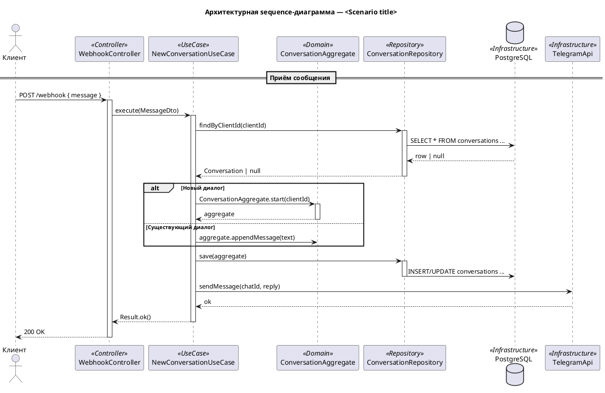

# Architectural Sequence Diagram for a Use Case

Generate ONE PlantUML sequence diagram that shows the **architectural flow** of a single use case — how the request passes through application layers (Controller → Use Case → Domain → Repository → Infrastructure) and what each layer does.

**A "use case" here means a Clean Architecture / DDD code construct**, typically a TypeScript class in a file named `*.use-case.ts` or `*.usecase.ts` that orchestrates one application scenario. **Not** the business-level `.puml` use-case diagram from `in-arch-use-case-diagrams`.

**Audience:** developers who need to see HOW one specific scenario is implemented inside the application — the orchestration between layers, not the business value.

This skill is distinct from:
- `in-arch-use-case-diagrams` — business-level **black box** (no internal architecture)
- `in-arch-dynamic-diagrams` — C4 **container-level** runtime flow across deployable units
- `in-arch-c4-code` — static code structure (classes, methods) without runtime sequence

This skill shows **application-architecture layers** inside one container for **one scenario** at a time.

## Step 1 — Determine the Source

The skill operates in two modes:

### Mode A — Existing use case in code (typical case)

If the user invoked the skill with a path/reference to a use case source file (typically `*.use-case.ts`, `*.usecase.ts`, or the equivalent in another language — e.g. `src/modules/conversation/application/start-conversation.use-case.ts`):

1. Read that file.
2. Read its direct collaborators (see Step 2) to discover the real layer names and call chain.
3. Proceed to Step 3.
4. The output file goes **next to the source file**, with the same base name (extension swapped) and the suffix `.sequence.puml`.
   - `src/modules/conversation/application/start-conversation.use-case.ts` → `src/modules/conversation/application/start-conversation.use-case.sequence.puml`
   - `src/modules/booking/application/assign-manager.usecase.ts` → `src/modules/booking/application/assign-manager.usecase.sequence.puml`

The file lives **next to the code**, never under `docs/`.

### Mode B — No use case file provided

If no source was specified, ask the user exactly:

> Для какого use case построить архитектурную sequence-диаграмму?
> 1. Для существующего use case — укажите путь к файлу с реализацией (обычно `*.use-case.ts`).
> 2. С нуля — опишите сценарий текстом, и я сгенерирую диаграмму до реализации (этот вариант используется редко, обычно при проектировании новой фичи перед написанием кода).

Then act based on the answer:

- **Existing use case** → switch to Mode A using the provided path.
- **From scratch** → use the user's textual description as the source. Ask where to save the file:
  > Куда сохранить диаграмму? Обычно её кладут рядом с будущим файлом use case. Укажите путь (например, `src/modules/<feature>/application/<slug>.use-case.sequence.puml`).

## Step 2 — Gather Architectural Context

Before drawing layers, you need to know **what the use case actually calls** and **what each collaborator is**. For Mode A, the use case source file is the primary source of truth.

For an existing use case (Mode A):

1. Read the use case file itself — its constructor (injected dependencies are the collaborators), its `execute` / `handle` / equivalent method, and its branches.
2. Read each **direct collaborator** referenced by the use case:
   - Repository / Gateway interfaces and at least one implementation (to know what IO it does).
   - Domain entities / aggregates / domain services the use case calls.
   - DTOs / commands / queries the use case accepts and returns.
3. Read the **caller** of the use case if you can find it cheaply — typically a controller or message handler that constructs the input DTO. Grep for the use case class name to locate callers.
4. Skim `CLAUDE.md`, `README.md`, and the source layout to detect the architectural style (Clean / Hexagonal / DDD / layered) and confirm folder naming conventions (`application/`, `domain/`, `infrastructure/`, `interface/`, etc.).
5. If `docs/architecture/c4-3-component.puml` exists, glance at it to reconcile names — but the **code is authoritative**, not the C3 diagram.

For from-scratch (Mode B), there's no code to read. Use the user's description plus the project's existing architectural style (inferred from sibling use cases or CLAUDE.md) to invent consistent layer names.

If something is ambiguous (e.g. a method call where you can't tell whether it's domain logic or infrastructure), prefer to **read more code** rather than guess. The whole value of this diagram is that it reflects the real call chain.

## Step 3 — Identify Architectural Layers for This Scenario

Pick the participants that appear in this **specific** scenario. Don't draw layers the scenario doesn't touch.

Typical participants, top to bottom:

| Layer | Role | Examples |
|-------|------|----------|
| `actor` | Human user or external trigger | Client, Manager, Scheduler |
| Controller / Edge | Entry point — accepts the request | `WebhookController`, `POST /api/x`, `TelegramHandler` |
| Use Case / Application Service | Orchestrator — coordinates the flow | `NewConversationUseCase`, `AssignClientService` |
| Domain Service / Aggregate | Pure business logic, invariants | `ConversationAggregate`, `PricingPolicy` |
| Repository / Gateway | Data access abstraction | `ConversationRepository`, `ClientGateway` |
| Infrastructure | Concrete IO — DB, queue, third-party API | `PostgresClient`, `TelegramApi`, `OpenAiClient` |
| External system | Real third party | `Telegram`, `OpenAI`, `Stripe` |

**Rules of thumb:**
- Use the participant name from C3 if it exists — don't invent a parallel vocabulary.
- Skip layers the scenario doesn't traverse (e.g. a read-only query may not touch domain logic).
- Names must reflect the **architectural role**, not just the technology (`ConversationRepository`, not `db`).
- Only include external systems the scenario actually reaches.

## Step 4 — Write the Diagram

### File template

### Conventions

**`@startuml` name and title**
- `@startuml` name: `UC_<PascalCaseScenario>_Sequence` — unique per file.
- Title prefix in Russian when sources are Russian: `Архитектурная sequence-диаграмма — <name>`. Otherwise English.

**Participant stereotypes**
- Tag each participant with its architectural layer via `<<Controller>>`, `<<UseCase>>`, `<<Domain>>`, `<<Repository>>`, `<<Infrastructure>>`, `<<External>>`.
- This is the main visual cue that this is an *architectural* sequence, not a business one.

**Messages**
- Show **method calls with arguments**, not user-visible text: `uc.execute(MessageDto)`, `repo.findByClientId(clientId)`.
- For DB / external HTTP, show the operation: `SELECT * FROM conversations WHERE ...`, `POST /sendMessage { chat_id, text }`.
- Responses: only draw them when the caller actually consumes the response (a `Conversation`, a token, a row). Skip trivial `ok` acks unless they affect flow.
- Use `-->` (dashed) for responses, `->` (solid) for calls.

**Activation bars**
- Activate the controller when the request arrives, deactivate when the response is sent.
- Activate each layer when it starts working, deactivate when it returns.
- Keep activations balanced.

**Flow control**
- Use `alt` / `else` for branches (new vs existing entity, success vs failure).
- Use `opt` for optional steps.
- Use `loop` for iterations (batch processing, retries with cap).
- Use `par` only when there's genuine parallelism (e.g. fire-and-forget side effects).

**Dividers**
- `== Phase name ==` separates logical phases: «Приём сообщения», «Бизнес-логика», «Сохранение», «Ответ пользователю».

**Notes**
- Use notes for **architectural rationale** that doesn't fit in a message label: "Транзакция оборачивает save + sendMessage через outbox", "Idempotency-ключ берётся из message_id".
- Notes are NOT for restating what the message label already says.

### What to Include

- Method calls between layers, with argument names.
- Returns that the caller depends on.
- Branches that change the architectural path (different repository, different external).
- Cross-cutting concerns visible in the flow: transactions, outbox, retries, idempotency — as notes or wrappers.
- Errors that change control flow (validation fail → 400, domain rule violation → 422).

### What NOT to Include

- User-visible text from the use case file (those belong in the business diagram).
- Multi-scenario orchestration (one file = one scenario).
- Implementation details below method level (no SQL syntax errors, no driver-specific calls).
- Layers the scenario doesn't traverse, even if they exist in the architecture.
- Full request/response JSON schemas — name the DTO instead (`MessageDto`).

## Step 5 — Save and Report

Write the diagram file to the location decided in Step 1:

- **Mode A** — next to the source code file, same base name + `.sequence.puml` (e.g. `start-conversation.use-case.ts` → `start-conversation.use-case.sequence.puml`). Never put it under `docs/`.
- **Mode B from scratch** — wherever the user agreed (typically next to the future use case file).

Report:
- The file path written.
- Any architectural gaps you noticed while reading the code (e.g. the use case bypasses the repository and calls the DB driver directly, the controller is doing domain work, a missing port/adapter).
- A one-line suggestion if the diagram exposes a design smell (god use case, repository leaking domain types, controller skipping the use case layer, etc.).

## PlantUML General Rules

- Self-contained `.puml` file, renders independently.
- Unique `@startuml <Name>` per file.
- Aliases meaningful (`ctrl`, `uc`, `repo`) — never `a`, `b`, `c`.
- Same language as the source spec (typically Russian here) for titles, dividers, and notes; method names stay in code (English).

## Quality Checklist

Before finishing, verify:
- [ ] Exactly ONE diagram per use case (one input scenario → one `.sequence.puml` file).
- [ ] Output path is correct: next to the use case **source code** with `.sequence.puml` suffix (Mode A), or the agreed location for from-scratch (Mode B). Never under `docs/`.
- [ ] Every participant has a stereotype (`<<Controller>>`, `<<UseCase>>`, ...).
- [ ] Layer names mirror the real class / file names from code (not invented).
- [ ] Messages are method calls with arguments, not user-visible text.
- [ ] Only meaningful responses are drawn (`-->`); trivial acks are skipped.
- [ ] Activation/deactivation is balanced.
- [ ] Branches use `alt` / `opt` / `loop` correctly.
- [ ] Notes carry architectural rationale, not duplicate message labels.
- [ ] No DB / external system appears unless the scenario actually touches it.
- [ ] Diagram renders independently.
