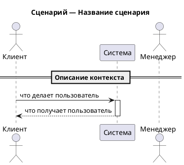

# Use Case Diagram Generator (Business Level)

Generate **business-level** sequence diagrams in PlantUML (.puml) format — one file per user scenario, organized by actor role.

**Audience:** developers who need to understand WHAT the system does and WHY, not HOW it works inside.

**Key principle:** the system is a **black box**. Diagrams show interactions between actors and the system (or between actors through the system). No internal components, no databases, no services — just observable behavior and business value.

## Step 1 — Collect Source Documents

If technical specification documents were not provided in the current conversation, ask:

> Укажите ссылки на техническую документацию/спецификацию для генерации бизнес-сценариев.

Read each document. If the user has already provided documents (via @ mentions or direct paths), proceed with those.

**Do NOT read architecture diagrams** — this skill intentionally ignores internal structure.

## Step 2 — Identify Actors and Scenarios

Based on the spec, identify:
1. **Actors** (roles) — each role becomes a subfolder
2. **Business scenarios** — each scenario becomes a separate `.puml` file
3. **System-initiated scenarios** — automated processes go into a `system/` folder

### How to classify scenarios

| Folder | What goes here | Initiator |
|--------|---------------|-----------|
| `<role>/` | Scenarios where a human actor initiates an action | Human user |
| `system/` | Automated processes, timeouts, scheduled events | System/timer/event |

Folder names for roles: kebab-case, lowercase, in English (e.g., `client/`, `manager/`, `system/`).

### Scenario selection guidelines

- Each scenario represents **one complete user story** from trigger to observable outcome
- Focus on **value delivered** — what the user achieves, not how the system processes it
- A scenario should answer: "What can the user do and what do they get?"
- If a scenario has branches (success/failure), include them as `alt`/`else` in one diagram
- Don't split trivial variations into separate diagrams

## Step 3 — Generate Diagrams

### Output Structure

```
docs/use-cases/
├── <role-1>/
│   ├── uc-<scenario>.puml
│   └── uc-<scenario>.puml
├── <role-2>/
│   └── uc-<scenario>.puml
└── system/
    └── uc-<scenario>.puml
```

**Naming rules:**
- Role subfolder names: kebab-case, English (e.g., `client/`, `manager/`, `system/`)
- Scenario file names: `uc-<scenario-name-kebab>.puml`
- No numbering — names should be descriptive

### Sequence Diagram Template



### Diagram Rules

#### Participants — Black Box Approach

- `actor` — human roles (client, manager, admin)
- `participant "Система"` — the entire system as ONE participant (black box)
- `participant "Telegram"` or `participant "Email"` — external channels, ONLY if the scenario involves channel-specific behavior visible to the user
- **NEVER** use: database, queue, internal service, component, microservice as participants
- **NEVER** show: SQL queries, API calls between services, internal routing, data transformations
- If two actors interact through the system, the system is the intermediary

#### Messages — User-Visible Actions Only

- Messages describe **what the user does** and **what they observe**
- Use natural language, as if describing the scenario to a non-technical person
- Include exact UI text, bot messages, and notifications from the spec

Good examples:
```
client -> system : Пишет сообщение боту
system --> client : "Привет! Я бот [Компании], попробую вам помочь."
system --> client : Ответ на основе базы знаний
system --> client : "Спасибо за обращение! Наш специалист скоро с вами свяжется."
manager -> system : Открывает список клиентов
system --> manager : Список с фильтрами по статусу, приоритету, менеджеру
```

Bad examples (TOO TECHNICAL — don't do this):
```
client -> webhookHandler : POST /webhook
webhookHandler -> sessionManager : createSession()
sessionManager -> db : INSERT INTO sessions
```

#### Flow Control

```plantuml
alt Бот смог ответить
    system --> client : Ответ из базы знаний
else Бот не смог ответить (после 3 попыток)
    system --> client : "Наш специалист скоро с вами свяжется."
    system --> manager : Клиент появляется в списке ожидающих
end

opt Клиент прикрепил файл
    client -> system : Отправляет файл
    system --> manager : Файл виден в переписке
end
```

#### Dividers

Use dividers to separate logical phases of the user journey:

```plantuml
== Первое обращение ==
...
== Общение с ботом ==
...
== Передача менеджеру ==
```

#### Notes — Business Context Only

Use notes for business rules that affect the user experience:

```plantuml
note right of system
    Бот делает максимум 3 попытки
    ответить, затем передаёт менеджеру
end note

note over client, manager
    Менеджер видит всю историю
    переписки клиента с ботом
end note
```

- Notes explain **why** the system behaves a certain way, not how
- Include limits and thresholds that affect UX (3 attempts, 24h timeout)
- No technical jargon: no "RAG", no "vector search", no "embeddings"

### What to Include

- User actions and their observable results
- Messages and notifications the user sees (exact text from spec)
- State transitions visible to the user (status changes, assignments)
- Business rules that affect behavior (limits, timeouts, permissions)
- Interactions between different actors through the system

### What NOT to Include

- Internal components, services, databases, queues
- API calls, SQL queries, data transformations
- Technical mechanisms (RAG, vector search, debounce, webhooks)
- Infrastructure (S3, Supabase, Telegram API internals)
- Error handling for technical failures

## PlantUML General Rules

- Each `.puml` file must be self-contained and renderable independently
- Use meaningful aliases for participants
- Write in the same language as the source documents (typically Russian)
- Keep message labels concise and human-readable
- Diagram should read as a **user story** from top to bottom

## Validate Syntax by Rendering

After writing the `.puml` files, render each one to PNG to confirm the PlantUML syntax is valid — a file that fails to render is broken no matter how correct the source looks.

1. Render every generated `.puml` to PNG, e.g. `plantuml -tpng docs/use-cases/**/*.puml` (or per-file `plantuml -tpng <file>.puml`). If PlantUML is not installed locally, fall back to any available renderer (Docker image `plantuml/plantuml`, the PlantUML server, etc.).
2. If a render fails, read the error, fix the `.puml` source, and re-render until every file succeeds.
3. **Delete the generated PNG files once rendering succeeds** — they are only a syntax check, not an artifact of this skill. Leave only the `.puml` sources.

Never leave `.png` files behind.

## Register in the docs index (if the project uses one)

The `.puml` files this skill produces are architecture documentation. If the project has adopted the docs-index convention (`docs/INDEX.md` — see the `in-docs-audit` / `in-docs-write` skills), the generated diagrams must be registered as first-class indexed docs; otherwise an agent routing through `docs/INDEX.md` never sees them.

1. Find the repo root (`git rev-parse --show-toplevel`) and check whether **`docs/INDEX.md` exists**.
2. **If it does not exist** — the project does not use the convention. Do nothing extra: leave the `.puml` sources exactly as generated, ignoring the in-docs rules. Do **not** bootstrap an index. Done.
3. **If it exists** — for every `.puml` you generated, apply the `in-docs-write` contract:
   - Insert a metadata header as a `'` comment block immediately after `@startuml`, with every field: `type: diagram`, `subtype: <SUBTYPE>`, `status`, `system`, `entities`, `answers` (2–5 concrete questions the diagram answers), `related`, `source_files`, `last_reviewed` (today). Values in the project's documentation language; field names stay English.
   - Add or update the diagram's entry under `### Diagram` in `docs/INDEX.md`, derived from that header (carry `subtype`). If the diagram's `system` is new, add it to `## Domains`.
   - Index the file **in place** — never move a diagram just to register it.
4. Verify before finishing: every generated `.puml` has a complete header **and** a matching `docs/INDEX.md` entry.

Subtype for this skill: `use-case`.

## Quality Checklist

Before finishing, verify:
- [ ] One file per scenario, in the correct role subfolder
- [ ] File names follow the `uc-<name>.puml` pattern
- [ ] The system is a BLACK BOX — no internal components visible
- [ ] Messages describe user-visible actions, not technical operations
- [ ] Exact messages/notifications from the spec are included in quotes
- [ ] No technical jargon (no RAG, no API, no DB, no webhook)
- [ ] A non-technical person can understand each diagram
- [ ] Business rules and limits are in notes, not in message labels
- [ ] Each diagram renders independently
- [ ] Every `.puml` was rendered to PNG to verify syntax, and the PNGs were deleted afterward
- [ ] Activation/deactivation is balanced
